# 《占地之王》软件说明书

> 用途：软件著作权登记随附材料（用户手册）
> 版本：V1.0
> 说明：本文已插入 12 张实际运行截图，位于 `screenshots/` 子目录，截图清单见 `screenshots/截图清单.md`。
> ⚠️ 当前截图基于工程现状拍摄（美术素材仍以占位图为主、`artAlpha=0.5`）。正式提交前须在完成素材替换后重拍并同名覆盖，勿直接提交带水印的版本。

---

## 1. 软件概述

### 1.1 软件名称

《占地之王》（简称：占地之王）

### 1.2 软件用途

一款运行于微信小游戏平台的六边形策略战棋游戏。玩家扮演一方势力首领，在六边形棋盘上通过探索翻格、资源经营、建筑建造、兵种生产与行军调度，逐步扩张领土并摧毁敌方大本营取得胜利。软件同时提供局外养成、任务、招募与排行榜等长线玩法。

### 1.3 运行环境

| 项目 | 要求 |
|---|---|
| 运行平台 | 微信小游戏（Android / iOS 微信客户端 8.0 及以上） |
| 基础库 | 微信基础库 3.x 及以上 |
| 网络 | 首次启动需网络下载美术资源分包；对局过程可离线运行 |
| 存储 | 本地存档（`wx.setStorageSync`），约 100KB |
| 开发预览环境 | Chrome / Edge 浏览器、微信开发者工具 2.02.x |

### 1.4 软件启动

在微信中搜索「占地之王」小游戏或扫描小程序码即可进入；首次启动显示加载页，页面显著位置常驻展示健康游戏忠告（抵制不良游戏，拒绝盗版游戏。注意自我保护，谨防受骗上当。适度游戏益脑，沉迷游戏伤身。合理安排时间，享受健康生活。），随后进入游戏大厅。软件无需安装、无需注册账号即可体验（原型阶段为本地存档）。


---

## 2. 软件总体结构

软件由「局外大厅」与「局内战斗」两大部分组成：

```
启动加载页
   │
   └─ 大厅（资源栏 / 玩家卡 / 功能入口 / 开战）
        ├─ 布阵        ─ 编组上阵兵种、调整建筑强化
        ├─ 招募        ─ 图鉴查看、单抽 / 十连
        ├─ 商店        ─ 免费领取、星尘兑换、训练物资、特惠
        ├─ 科技        ─ 4 分支科技树升级
        ├─ 任务 / 成就 ─ 每日与成就目标、一键领取
        ├─ 排行榜      ─ 4 类榜单查看
        ├─ 通行证      ─ 赛季奖励（功能开关控制，默认关闭）
        ├─ 设置        ─ 音效 / BGM 开关
        └─ 开战 → 战斗棋盘 → 战斗结算 → 返回大厅
```

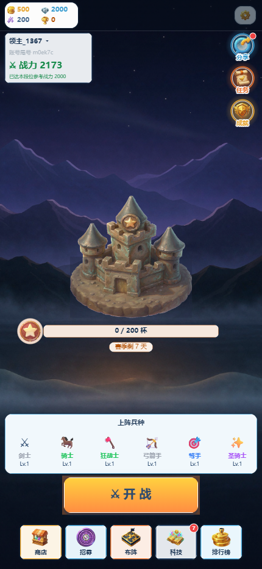

---

## 3. 大厅界面操作说明

### 3.1 顶部资源栏

屏幕顶部常驻资源栏，从左至右显示：玩家头像与等级、金币、星尘、钻石等资源数量。资源数量随对局与局外操作实时刷新。

### 3.2 玩家卡与功能入口

左上方为玩家信息卡，展示昵称、等级与战力。其下方为功能按钮行，包含商店、招募、任务等入口；部分入口受功能开关控制，关闭时不显示。

### 3.3 城堡与进度

大厅中央为主城城堡立绘与当前段位进度条，展示玩家段位、积分与下一档位所需进度。

### 3.4 上阵信息区

大厅下方展示当前上阵的兵种编组与羁绊状态，可点击「布阵」进入调整。

### 3.5 主操作按钮

底部为主操作区：「开战」按钮进入对战，「返回」按钮退出当前界面。所有界面左上角均提供返回入口，Android 系统返回键同样有效。

---

## 4. 局外功能界面

### 4.1 布阵界面

进入方式：大厅「布阵」按钮。

界面分为四个卡片区块：
- **上阵**：展示已上阵兵种，点击可查看详情；
- **羁绊**：展示当前激活的羁绊组合及加成；
- **强化**：建筑与兵种的局外强化项；
- **兵库**：全部可用兵种列表，可按品质筛选。

点击兵种卡可打开兵种详情浮层，展示属性、技能与羁绊说明。

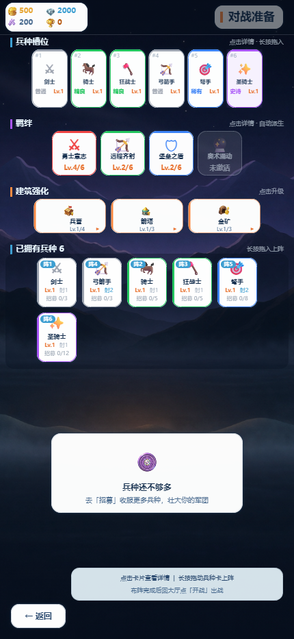

### 4.2 招募界面

进入方式：底部导航「招募」。

界面展示招募说明、概率公示、保底进度与兵种图鉴。提供「单抽」与「十连」两种操作；每次招募后展示结果卡片，并累积保底计数。概率与保底规则在界面内明示。

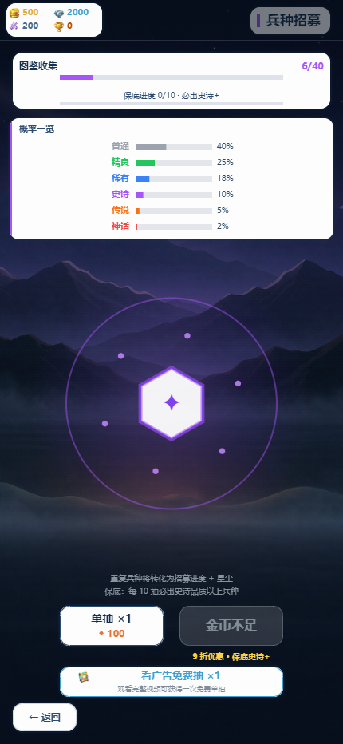

### 4.3 商店界面

进入方式：大厅「商店」按钮。

商店按分页组织商品：免费领取、星尘兑换、训练物资与特惠。免费商品每日限次，超出次数后需观看激励视频广告方可继续领取（广告位未配置时该入口不可用）。钻石充值分页与赛季通行证商品在当前版本默认关闭。

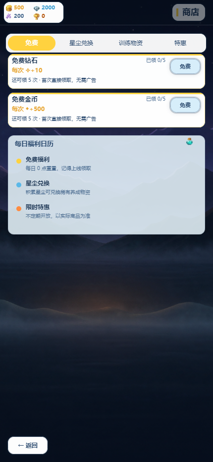

### 4.4 科技界面

进入方式：底部导航「科技」。

科技树分为四个分支，每个分支含多个节点。节点状态分为已解锁、可升级、未解锁三种，以不同底色与边框区分。点击可升级节点弹出花费确认，消耗星尘后提升对应属性。

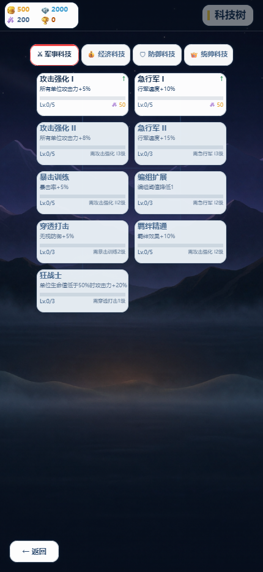

### 4.5 任务与成就界面

进入方式：大厅「任务」按钮。

任务页按分类展示每日与成长任务，已完成任务可领取奖励；成就页与任务页共用列表样式，展示各成就达成进度。列表顶部提供「一键领取」按钮。

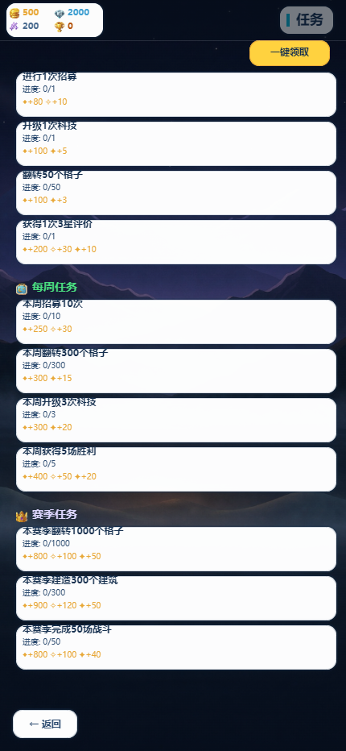

### 4.6 排行榜界面

进入方式：底部导航「排行榜」。

提供四类榜单分页，每页展示前 20 名。前三名使用金/银/铜标识，玩家自身所在行使用高亮标记。榜单为本地展示数据（原型阶段）。

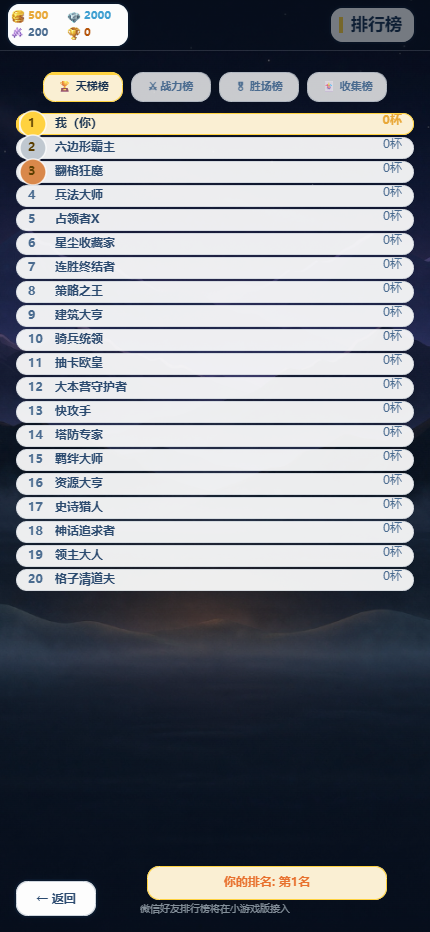

### 4.7 设置界面

进入方式：大厅右上角设置图标。

提供音效开关、背景音乐开关与音量调节。设置项即时生效并写入本地存档。

---

## 5. 战斗流程操作说明

### 5.1 进入战斗

在大厅点击「开战」，软件生成一张 11×7（77 格）六边形地图，双方初始金币均为 200。地图含平原、矿点、障碍等地形，并随机分布未翻格与建筑。

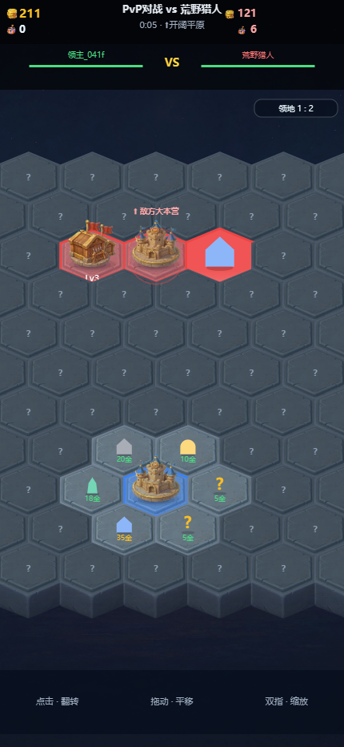

### 5.2 翻格

点击相邻未翻格消耗金币即可翻开，翻开后显示地形、建筑或随机事件。未翻格中的建筑以剪影形式预告类型，翻开后显示完整图标与等级。

### 5.3 建造与经营

翻开地块后可在可用格上建造兵营、箭塔、金矿等建筑。建筑随时间自动产出金币或战士；玩家可通过升级提升产出效率。

### 5.4 产兵与行军

兵营累积战士达到编组阈值（9 名）后自动编队，沿 A* 寻路结果向目标推进。玩家可点击己方建筑指定集结点与进攻目标。行军队伍以颜色区分阵营：玩家为蓝色，敌方为红色。

### 5.5 交战与攻城

队伍相遇时按攻击力、防御力与五档阈值结算伤害；远程兵种先手削减目标兵力。攻城为持续磨血机制，队伍摧毁敌方建筑后占领地块。摧毁对方大本营即获胜，己方大本营被毁则失败。

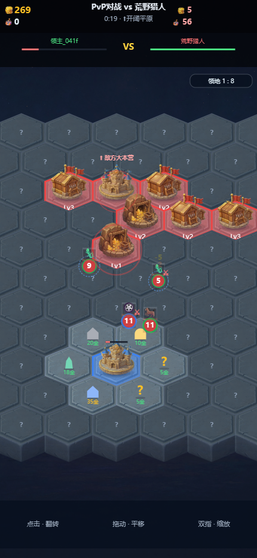

### 5.6 战斗操作辅助

- **缩放**：双指捏合缩放棋盘，范围 0.5～2.0 倍，默认倍率按屏幕尺寸自适应放大；
- **平移**：单指拖动查看棋盘全局；
- **暂停/返回**：Android 系统返回键可退出当前对局。

### 5.7 战斗结算

对局结束后进入结算界面，展示胜负结果、战绩数据与奖励。胜利时显示「炫耀战绩」分享按钮与「返回大厅」主按钮；失败时仅显示「返回大厅」。点击空白区域不会误退出，须通过按钮或系统返回键离开。


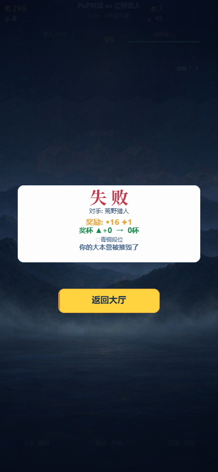

### 5.8 未成年人保护

首次进入游戏时显示适龄提示（8+），须确认后方可继续操作。设置窗口提供「实名认证」引导入口与「青少年模式」开关：开启青少年模式后，每日可玩时长上限收紧为 30 分钟；标记为未成年人的账号仅可在周五、周六、周日 20:00–21:00 游玩。触及时段或时长限制时弹出保护提示，须确认后返回。

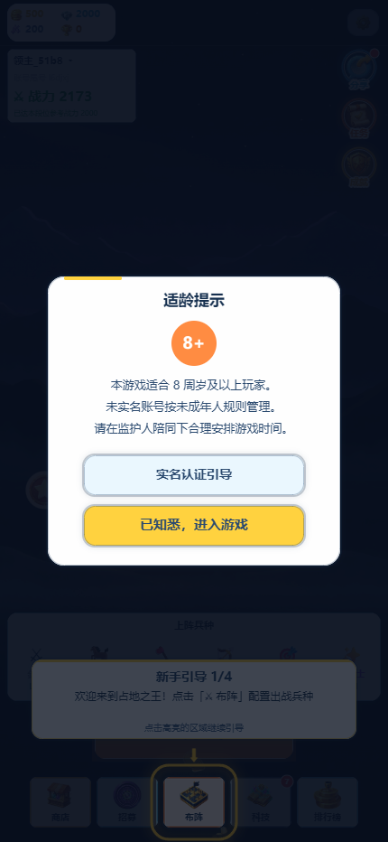

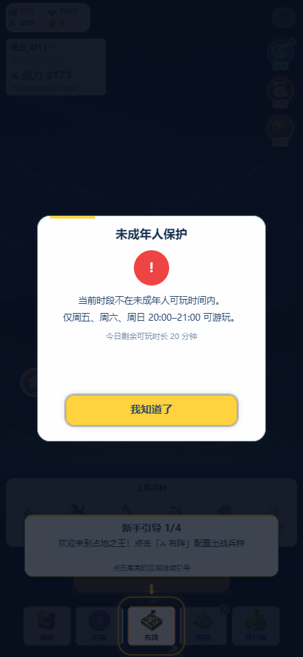

> 说明：当前版本实现的是前端引导与本地时长/时段管控；真实身份核验须由服务端对接具备资质的实名认证系统后生效。软件不收集、不上传用户个人信息。

---

## 6. 软件特点

1. **确定性对局**：采用 Mulberry32 种子随机数，同样种子与操作序列产生完全一致的对局结果，便于复盘与自动化测试。
2. **多分辨率适配**：布局按 430×932 基准缩放，适配 320×568 至 430×932 的移动端屏幕，并针对灵动岛/摄像孔区域做了安全区处理。
3. **渲染与命中共源**：所有界面元素的绘制坐标与点击命中区域由同一布局函数产出，避免错位。
4. **资源分包**：美术资源置于微信分包按需加载，主包体积控制在 4MB 限制内；首屏字体与加载图置于主包保证启动可用。
5. **静默降级**：字体、音频、广告等可选能力加载失败时自动回退系统能力，不影响核心玩法运行。
6. **自动化测试**：内置 74 项回归测试，覆盖玩法逻辑、界面布局、微信入口适配、分包配置与合规系统校验。
7. **未成年人保护**：提供适龄提示、实名认证引导、青少年模式与时/段管控，状态本地保存、不上传个人信息；可选能力加载失败时静默降级。

---

## 7. 常见问题

| 问题 | 处理方式 |
|---|---|
| 首次启动较慢 | 首次进入需下载美术资源分包，请保持网络畅通；后续启动使用缓存 |
| 看不到自定义字体 | 开发者工具模拟器不支持加载本地字体，属正常现象，真机/体验版正常显示 |
| 点击「看广告」无反应 | 广告位 ID 尚未配置，广告功能默认关闭 |
| 商店无钻石充值入口 | 该功能受版号合规开关控制，当前默认关闭 |
| 找不到赛季通行证 | 该功能默认关闭，待版本审核通过后开启 |
| 战斗画面可缩放 | 双指捏合；若手机设置了系统手势缩放，可能需要在系统设置中关闭 |

---

## 8. 版本信息

| 版本 | 说明 |
|---|---|
| V1.0 | 首次登记版本；11×7 六边形棋盘、完整局外养成与战斗流程 |
